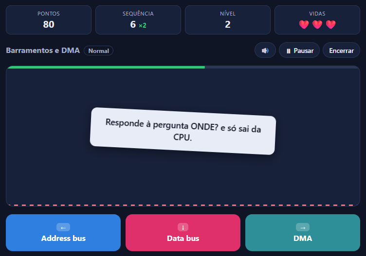

<div align="center">


# Classifica Rápido

### Leia a pista. *Jogue a carta na palavra certa.*

**Jogo para treinar as 16 palavras da aula de Tópicos de Arquitetura Computacional.**


<br /><br />

<a href="https://igor-fuchs01.github.io/arqcomp-classifica-rapido/">
  
</a>

</div>

<div align="center">
  <br>
  
  
  <br><br>
</div>

## 🃏 Sobre o projeto

O Classifica Rápido é o jogo da Atividade Avaliativa III da disciplina de Arquitetura Computacional (Sprint 3) do curso de Análise e Desenvolvimento de Sistemas da SPTech. Cada carta que cai traz uma **pista** e as caixas embaixo são as **palavras**: o jogador lê a pista e joga a carta na palavra certa antes que ela chegue ao fim. Se errar, o jogo mostra a resposta com a explicação.

As pistas seguem as regras da atividade: têm no máximo 15 palavras, não contêm a resposta, nem parte dela, nem a sigla por extenso, e levam a uma única resposta entre as caixas.

O modo principal é o **★ Desafio completo**, que mistura as 85 pistas das 16 palavras. Para treinar por partes, há **5 níveis**:

| | Nível | Capítulo | Palavras (caixas) |
|:---:|---|:---:|---|
| ★ | **Desafio completo** (modo principal) | todos | as 16 palavras, as caixas mudam a cada carta |
| 1 | **Dentro da CPU** | 2.1 | CPU · ULA · UC · Registradores |
| 2 | **Tipos de memória** | 5 | RAM · ROM · EEPROM · Flash |
| 3 | **Hierarquia de memória** | 5.1 | Registradores · Cache · RAM · Memória de massa |
| 4 | **Barramentos e DMA** | 4 e 6 | Address bus · Data bus · DMA |
| 5 | **Microcontrolador e núcleos** | 3 | Microcontrolador · Dual core · Quad core |

## 🎮 Como jogar

Escolha a **dificuldade** e jogue o **Desafio completo** ou um **nível**. Depois da contagem regressiva, a carta com a pista cai e você escolhe a caixa com a palavra:

| Ação | Teclado | Celular / mouse |
|---|---|---|
| Escolher a caixa | <kbd>←</kbd> <kbd>↓</kbd> <kbd>→</kbd> ou <kbd>1</kbd> a <kbd>4</kbd> | toque ou clique na caixa |
| Pular a explicação | <kbd>Enter</kbd> | toque na área do jogo |
| Pausar | <kbd>P</kbd> | botão **Pausar** |
| Encerrar a partida | <kbd>Esc</kbd> | botão **Encerrar** |

| | Dificuldade | Como funciona |
|:---:|---|---|
| 📘 | **Treino** | A carta não cai e você não perde vidas. Toda resposta mostra a explicação. |
| ⚡ | **Normal** | 3 vidas. Errar ou deixar a carta chegar ao fim custa uma vida. |
| 🔥 | **Difícil** | 2 vidas e as cartas caem 30% mais rápido. |

- A barra no topo mostra quanto tempo falta, e a carta fica vermelha quando está perto do fim.
- A cada 5 acertos as cartas caem mais rápido (**Nível 2!**), e a cada 5 acertos seguidos os pontos valem mais (**Combo ×2!**, até ×4).
- **Estrelas:** cada nível dá ★ com 5 acertos numa partida, ★★ com 10 e ★★★ acertando todas as pistas do nível.
- No fim da partida aparecem as estrelas, os pontos, a precisão e a lista **Para revisar**, com cada pista errada e a explicação. Recordes e estrelas ficam salvos no navegador.

## 📝 Palavras e pistas

O jogo usa as **16 palavras** da atividade. Cada uma tem de 3 a 9 pistas (registradores e RAM aparecem em dois níveis); abaixo, uma pista de cada palavra:

| Nº | Palavra | Pista | Nº de pistas |
|:---:|---|---|:---:|
| 1 | **CPU** | Bloco que busca e executa as instruções do programa. | 5 |
| 2 | **ULA** | Calcula o 4 quando a instrução ADD 2, 2 é executada. | 5 |
| 3 | **UC (Unidade de Controle)** | Lê cada instrução, descobre o que ela pede e dá as ordens. | 5 |
| 4 | **registradores** | Memórias minúsculas dentro da CPU, as mais rápidas do computador. | 8 |
| 5 | **RAM** | Memória de trabalho: guarda os programas em execução e seus dados. | 9 |
| 6 | **ROM** | Nas primeiras versões, era gravada na fábrica e nunca mais mudava. | 3 |
| 7 | **EEPROM** | Memória não volátil de apenas 1 KB no Arduino Uno. | 4 |
| 8 | **Flash** | Guarda o programa do Arduino Uno e tem 32 KB. | 5 |
| 9 | **cache** | Guarda cópia do que a CPU usou há pouco, para não ir à RAM. | 5 |
| 10 | **memória de massa (armazenamento)** | SSD ou HD. | 6 |
| 11 | **DMA** | Um controlador próprio copia entre o dispositivo e a RAM, liberando a CPU. | 6 |
| 12 | **address bus (barramento de endereço)** | Responde à pergunta ONDE? e só sai da CPU. | 5 |
| 13 | **data bus (barramento de dados)** | Responde à pergunta O QUÊ? e vai e volta. | 5 |
| 14 | **microcontrolador** | CPU, memória e entrada e saída reunidas num único chip. | 6 |
| 15 | **dual core** | Processador com duas unidades de processamento independentes no mesmo chip. | 4 |
| 16 | **quad core** | Processador com quatro unidades de processamento independentes no mesmo chip. | 4 |

<details>
<summary><strong>Ver todas as 85 pistas</strong></summary>

**1. CPU**

- Bloco que busca e executa as instruções do programa. *(Dentro da CPU)*
- Formada por ULA, UC e registradores. *(Dentro da CPU)*
- Um dos três blocos do computador, ao lado da memória e da entrada e saída. *(Dentro da CPU)*
- No Arduino Uno, é o núcleo do ATmega328P, rodando a 16 MHz. *(Dentro da CPU)*
- Repete sem parar o ciclo de busca e execução. *(Dentro da CPU)*

**2. ULA**

- Calcula o 4 quando a instrução ADD 2, 2 é executada. *(Dentro da CPU)*
- Faz soma, subtração e as operações AND, OR, XOR e NOT. *(Dentro da CPU)*
- Circuito construído a partir de somadores, como o meio somador do Logisim. *(Dentro da CPU)*
- Na analogia da cozinha, é quem cozinha. *(Dentro da CPU)*
- Recebe a ordem da UC e entrega o resultado ao acumulador. *(Dentro da CPU)*

**3. UC (Unidade de Controle)**

- Lê cada instrução, descobre o que ela pede e dá as ordens. *(Dentro da CPU)*
- Decodifica a instrução e comanda as outras partes da CPU. *(Dentro da CPU)*
- Na analogia da cozinha, faz o papel de chef. *(Dentro da CPU)*
- Reconhece que ADD 2, 2 é uma soma e manda a ULA calcular. *(Dentro da CPU)*
- Parte da CPU que comanda, mas não faz contas. *(Dentro da CPU)*

**4. registradores**

- Memórias minúsculas dentro da CPU, as mais rápidas do computador. *(Dentro da CPU)*
- Acumulador, Contador de Programa e o de Instrução são exemplos deles. *(Dentro da CPU)*
- Guardam o dado que a CPU está usando neste exato momento. *(Dentro da CPU)*
- Na analogia da cozinha, são a bancada. *(Dentro da CPU)*
- Um deles, o PC, guarda a posição da próxima instrução. *(Dentro da CPU)*
- Topo da pirâmide: poucos bytes, colados na ULA. *(Hierarquia de memória)*
- A camada mais rápida e mais cara por byte. *(Hierarquia de memória)*
- Fica dentro da CPU e guarda o dado em uso agora. *(Hierarquia de memória)*

**5. RAM**

- Memória de trabalho: guarda os programas em execução e seus dados. *(Tipos de memória)*
- Onde fica a variável que zera quando o Arduino é desligado. *(Tipos de memória)*
- No Arduino Uno tem 2 KB; no notebook, alguns gigabytes. *(Tipos de memória)*
- A CPU lê qualquer posição dela no mesmo tempo. *(Tipos de memória)*
- Volátil: perde todo o conteúdo quando a energia acaba. *(Tipos de memória)*
- Memória principal, com alguns GB no notebook. *(Hierarquia de memória)*
- Responde em cerca de 100 ns, 200 vezes mais lenta que a L1. *(Hierarquia de memória)*
- Onde a API do projeto roda, no notebook. *(Hierarquia de memória)*
- Fica na placa-mãe e guarda os programas em execução. *(Hierarquia de memória)*

**6. ROM**

- Nas primeiras versões, era gravada na fábrica e nunca mais mudava. *(Tipos de memória)*
- Guarda o que o equipamento precisa para começar a funcionar. *(Tipos de memória)*
- Onde fica a BIOS ou a UEFI; hoje costuma ser feita com Flash. *(Tipos de memória)*

**7. EEPROM**

- Memória não volátil de apenas 1 KB no Arduino Uno. *(Tipos de memória)*
- Onde o próprio programa guarda uma configuração que sobrevive ao desligamento. *(Tipos de memória)*
- Terceira memória do ATmega328P, além da Flash e da RAM. *(Tipos de memória)*
- Pequena e não volátil: guarda dados do programa, não o programa. *(Tipos de memória)*

**8. Flash**

- Guarda o programa do Arduino Uno e tem 32 KB. *(Tipos de memória)*
- Mesma tecnologia do pendrive: não volátil e regravável. *(Tipos de memória)*
- Graças a ela, dá para gravar programas novos no Arduino pela IDE. *(Tipos de memória)*
- Dos seus 32 KB no Uno, 0,5 KB já vêm ocupados de fábrica. *(Tipos de memória)*
- Por ser regravável, permite atualizar o firmware da placa-mãe. *(Tipos de memória)*

**9. cache**

- Guarda cópia do que a CPU usou há pouco, para não ir à RAM. *(Hierarquia de memória)*
- Camada de KB a MB, entre os registradores e a memória principal. *(Hierarquia de memória)*
- O ATmega328P do Arduino Uno não tem esta camada. *(Hierarquia de memória)*
- No nível 1, responde em cerca de 0,5 ns. *(Hierarquia de memória)*
- Pequena, muito rápida e volátil, fica dentro do processador. *(Hierarquia de memória)*

**10. memória de massa (armazenamento)**

- SSD ou HD. *(Hierarquia de memória)*
- Base da pirâmide: centenas de GB a TB. *(Hierarquia de memória)*
- A única camada não volátil da pirâmide. *(Hierarquia de memória)*
- Onde o banco de dados guarda a leitura do LM35 para sempre. *(Hierarquia de memória)*
- A camada mais lenta e mais barata por byte. *(Hierarquia de memória)*
- Guarda arquivos e programas instalados de forma permanente. *(Hierarquia de memória)*

**11. DMA**

- Um controlador próprio copia entre o dispositivo e a RAM, liberando a CPU. *(Barramentos e DMA)*
- A CPU só configura a cópia e recebe um aviso no fim. *(Barramentos e DMA)*
- Placas de rede, som e vídeo usam isso para transferir dados. *(Barramentos e DMA)*
- O ATmega328P não tem; o ESP32 tem. *(Barramentos e DMA)*
- Não dá prioridade a dados importantes: só muda quem faz a cópia. *(Barramentos e DMA)*
- Permite copiar um vídeo do pendrive enquanto você navega sem travar. *(Barramentos e DMA)*

**12. address bus (barramento de endereço)**

- Responde à pergunta ONDE? e só sai da CPU. *(Barramentos e DMA)*
- Fios que levam o número da posição de memória a acessar. *(Barramentos e DMA)*
- Com 11 fios, alcança 2.048 posições: o tamanho da RAM do Uno. *(Barramentos e DMA)*
- Seu número de fios define quantas posições a CPU acessa. *(Barramentos e DMA)*
- Primeiro passo da leitura: a CPU coloca nele a posição desejada. *(Barramentos e DMA)*

**13. data bus (barramento de dados)**

- Responde à pergunta O QUÊ? e vai e volta. *(Barramentos e DMA)*
- Leva o valor lido ou escrito entre a CPU e a memória. *(Barramentos e DMA)*
- Também leva as instruções da memória até a CPU. *(Barramentos e DMA)*
- Na leitura, a memória coloca nele o conteúdo pedido. *(Barramentos e DMA)*
- Seu tamanho não muda quantas posições a CPU alcança. *(Barramentos e DMA)*

**14. microcontrolador**

- CPU, memória e entrada e saída reunidas num único chip. *(Microcontrolador e núcleos)*
- O ATmega328P do Arduino Uno é um exemplo. *(Microcontrolador e núcleos)*
- Chip barato e de baixo consumo, feito para uma tarefa específica. *(Microcontrolador e núcleos)*
- ESP32, PIC e STM32 são exemplos usados na indústria. *(Microcontrolador e núcleos)*
- Comanda a máquina de lavar: escolhe o tempo de cada etapa e liga o motor. *(Microcontrolador e núcleos)*
- Já traz conversor analógico-digital e comunicação serial embutidos. *(Microcontrolador e núcleos)*

**15. dual core**

- Processador com duas unidades de processamento independentes no mesmo chip. *(Microcontrolador e núcleos)*
- Executa duas tarefas ao mesmo tempo, uma em cada unidade. *(Microcontrolador e núcleos)*
- Tem metade das unidades de processamento de um processador de quatro. *(Microcontrolador e núcleos)*
- Dois conjuntos de ULA, UC e registradores trabalhando juntos num chip. *(Microcontrolador e núcleos)*

**16. quad core**

- Processador com quatro unidades de processamento independentes no mesmo chip. *(Microcontrolador e núcleos)*
- Executa quatro tarefas ao mesmo tempo, uma em cada unidade. *(Microcontrolador e núcleos)*
- Tem o dobro das unidades de processamento de um processador de duas. *(Microcontrolador e núcleos)*
- Quatro conjuntos de ULA, UC e registradores trabalhando juntos num chip. *(Microcontrolador e núcleos)*

</details>

## ⚙️ Como rodar

Não precisa instalar nada: o jogo é feito só com HTML, CSS e JavaScript puros, sem bibliotecas.

- **Online:** abra [igor-fuchs01.github.io/arqcomp-classifica-rapido](https://igor-fuchs01.github.io/arqcomp-classifica-rapido/).
- **No computador:** clone o repositório e abra o `index.html` no navegador, com dois cliques.

  ```bash
  git clone https://github.com/igor-fuchs01/arqcomp-classifica-rapido.git
  cd arqcomp-classifica-rapido
  ```

O site é publicado pelo GitHub Pages a partir da branch `main`: cada push atualiza o jogo em cerca de 1 minuto.

### Estrutura

| Arquivo | O que faz |
|---|---|
| `index.html` | As três telas: início, jogo e fim |
| `style.css` | Visual, tema claro e escuro, animações e layout para celular |
| `dados.js` | Os níveis, as palavras e as pistas |
| `script.js` | Queda das cartas, pontuação, estrelas, controles e sons |

Para criar uma pista nova, adicione uma linha no nível certo do `dados.js`. Em `resposta` vai a posição da palavra certa, começando em 0:

```js
{ texto: "Memória de trabalho: guarda os programas em execução.", resposta: 0, explicacao: "RAM: a memória de trabalho do computador." },
```

## 🔗 Links

| Documento | Link |
|---|---|
| Jogo publicado | [GitHub Pages](https://igor-fuchs01.github.io/arqcomp-classifica-rapido/) |

## 👤 Autor

| Nome | GitHub |
|---|---|
| Igor Pereira | [@igor-fuchs01](https://github.com/igor-fuchs01) |

<div align="center">

<br />

*A próxima pista já está caindo.*


</div>
